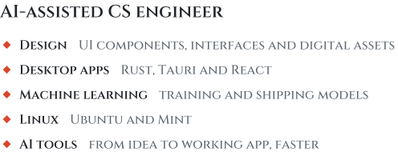

<picture><source media="(prefers-color-scheme: dark)" srcset="assets/divider-dark-v3.svg"></picture>

<picture>
  <source media="(prefers-color-scheme: dark)" srcset="assets/about-dark-v3.svg">
  
</picture>

  <a href="https://github.com/Iamshi-vissa?tab=repositories"><picture><source media="(prefers-color-scheme: dark)" srcset="assets/explore-dark-v3.svg"></picture></a>

  <a href="https://github.com/Iamshi-vissa"><picture><source media="(prefers-color-scheme: dark)" srcset="assets/github-dark.svg"></picture>&nbsp;<b>GitHub</b></a>
  &nbsp;&nbsp;&nbsp;&nbsp;
  <a href="https://www.linkedin.com/in/vamshi-bharath-3a1a4b348/">&nbsp;<b>LinkedIn</b></a>
  &nbsp;&nbsp;&nbsp;&nbsp;
  <a href="mailto:iamshi725@gmail.com">&nbsp;<b>Email</b></a>

