  

   

  <h1>Vamshi</h1>
  
<strong>SOFTWARE DEVELOPER</strong> Training models · designing digital assets · shipping software

   

  

    

  

    

  
  
  

 

  

## `01` // The character

I build complete products — **Python services** behind **TypeScript interfaces**, and desktop apps in **Rust** or **Electron** when the browser isn't enough. Lately my work leans into **ML on real data** and **pipelines that stay safe with untrusted input**.

<table>
  <tr>
    <td width="33%" align="center">
      <strong>◇ FULL-STACK</strong>  
      FastAPI services, Redis workers, Postgres &amp; React frontends.
    </td>
    <td width="33%" align="center">
      <strong>// ML &amp; DATA</strong>  
      Risk models on git history, retrieval over documents.
    </td>
    <td width="33%" align="center">
      <strong>+ DESKTOP &amp; TOOLS</strong>  
      Rust/Tauri IDE, Electron apps, CLIs &amp; git hooks.
    </td>
  </tr>
</table>

> **CURRENT ARC** 
> Shipping CommitRad, Hakobu and AKSHARA — one careful layer at a time.

 

## `02` // The toolkit

  
  
  
  
  
  
  
  
  
  
  
  
  
  

<table>
  <thead>
    <tr>
      <th>Layer</th>
      <th>Tools &amp; focus</th>
    </tr>
  </thead>
  <tbody>
    <tr>
      <td><strong>Build</strong></td>
      <td>Python · FastAPI · TypeScript · React · Next.js · Vite</td>
    </tr>
    <tr>
      <td><strong>Store &amp; run</strong></td>
      <td>PostgreSQL · Supabase · Redis / RQ · DuckDB · Docker</td>
    </tr>
    <tr>
      <td><strong>Model</strong></td>
      <td>LightGBM · pandas · FAISS · sentence-transformers · OpenCV</td>
    </tr>
    <tr>
      <td><strong>Ship native</strong></td>
      <td>Rust · Tauri v2 · Electron · Monaco</td>
    </tr>
  </tbody>
</table>

 

## `03` // Story arcs

<table>
  <thead>
    <tr>
      <th>Project</th>
      <th>What it does</th>
    </tr>
  </thead>
  <tbody>
    <tr>
      <td><a href="https://github.com/Iamshi-vissa/CommitRad"><strong>CommitRad</strong></a></td>
      <td>Scores every commit — even unpushed ones — for the risk it needs a bug fix, and says why. LightGBM trained on 27,384 commits. <code>Python · LightGBM · DuckDB · FastAPI · React</code></td>
    </tr>
    <tr>
      <td><a href="https://github.com/Iamshi-vissa/Hakobu"><strong>Hakobu</strong></a></td>
      <td>Universal file converter: detects a file's real type from its bytes. ~50 formats, 800+ paths, sandboxed workers. <code>FastAPI · Redis/RQ · Next.js · Docker</code></td>
    </tr>
    <tr>
      <td><a href="https://github.com/Iamshi-vissa/AKSHARA"><strong>AKSHARA</strong></a></td>
      <td>Document engineering platform to create, inspect and validate DOCX, PDF and PPTX, with immutable versioned storage. <code>FastAPI · PostgreSQL · Redis · React</code></td>
    </tr>
    <tr>
      <td><a href="https://github.com/Iamshi-vissa/X-Editor"><strong>X-Editor</strong></a></td>
      <td>Local-first desktop IDE with built-in runtime management for Node, Python and Rust. <code>Rust · Tauri v2 · React · Monaco</code></td>
    </tr>
    <tr>
      <td><a href="https://github.com/Iamshi-vissa/Docent"><strong>Docent</strong></a></td>
      <td>Multi-document Q&amp;A that answers only from your files, citing file and page. <code>Python · FAISS · FastAPI · Next.js</code></td>
    </tr>
    <tr>
      <td><a href="https://github.com/Iamshi-vissa/Shashin"><strong>Shashin</strong></a></td>
      <td>A private photo diary — one photo a day, visible only to friends, collected into weekly albums. <code>React · TypeScript · Supabase</code></td>
    </tr>
    <tr>
      <td><a href="https://github.com/Iamshi-vissa/X-WALL"><strong>X-WALL</strong></a></td>
      <td>Scam QR-code and payment-link analyzer: see where a code really sends you before you pay. <code>FastAPI · OpenCV · React</code></td>
    </tr>
    <tr>
      <td><a href="https://github.com/Iamshi-vissa/CoKo"><strong>CoKo</strong></a></td>
      <td>An animated desk buddy that tracks your sessions, focus and battery — and reacts to them. <code>Electron · JavaScript</code></td>
    </tr>
  </tbody>
</table>

 

## `04` // Contents

  

 

## `05` // Behind the panels

✦ A few things I enjoy making

- Tools that read the signals already sitting in your data — like risk hiding in git history.
- Pipelines that treat every input as untrusted and still feel instant.
- Desktop apps that feel native, not like a web page in a frame.
- Small companions and diaries that make a day a little nicer.

> **CREDO** 
> Every bug is a plot twist. Every fix is a new chapter.

 

## `06` // Next page

  
  
  

 

  

