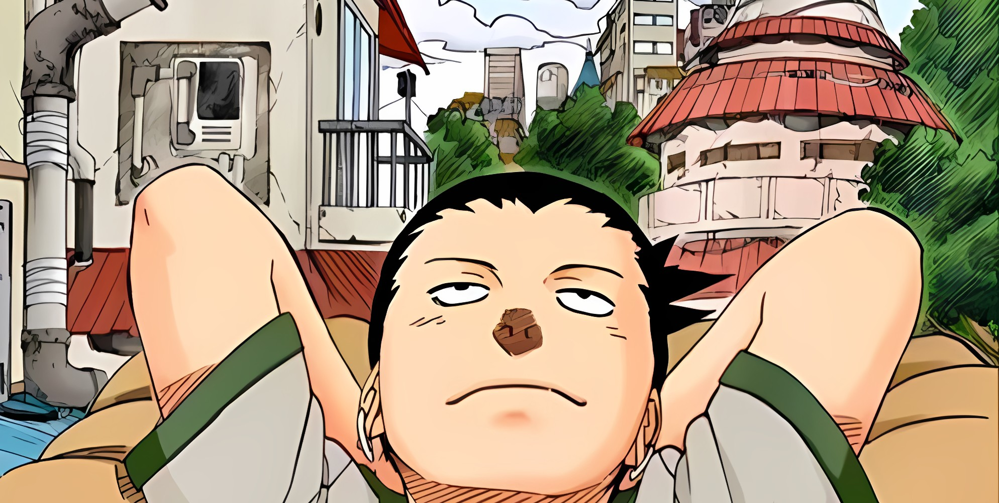

  

   

  <h1>Vamshi</h1>
  
<strong>SOFTWARE DEVELOPER</strong> Training models · designing digital assets · building software

   

  

    

  

    

  
  
  

 

  

## `01` // The character

I train models, design digital assets, and write the software that puts both in front of people.

<table>
  <thead>
    <tr>
      <th width="22%">Skill</th>
      <th>What I do</th>
      <th width="22%">Where to see it</th>
    </tr>
  </thead>
  <tbody>
    <tr>
      <td><strong>Training models</strong></td>
      <td>Gradient-boosted models on real-world data, embeddings and retrieval, and the evaluation work that tells you whether a model is actually right.</td>
      <td><a href="https://github.com/Iamshi-vissa/CommitRad">CommitRad</a> · <a href="https://github.com/Iamshi-vissa/Docent">Docent</a></td>
    </tr>
    <tr>
      <td><strong>Designing digital assets</strong></td>
      <td>Visual assets, interfaces and motion, designed together with the product rather than added at the end.</td>
      <td><a href="https://github.com/Iamshi-vissa/Shashin">Shashin</a> · <a href="https://github.com/Iamshi-vissa/CoKo">CoKo</a></td>
    </tr>
    <tr>
      <td><strong>Software development</strong></td>
      <td>End-to-end products: Python services, TypeScript frontends, and native desktop apps in Rust and Electron.</td>
      <td><a href="https://github.com/Iamshi-vissa/X-Editor">X-Editor</a> · <a href="https://github.com/Iamshi-vissa/Hakobu">Hakobu</a></td>
    </tr>
  </tbody>
</table>

 

## `02` // The toolkit

  
  
  
  
  
  
  
  
  
  
  
  
  
  

<table>
  <thead>
    <tr>
      <th>Layer</th>
      <th>Tools &amp; focus</th>
    </tr>
  </thead>
  <tbody>
    <tr>
      <td><strong>Model</strong></td>
      <td>LightGBM · pandas · FAISS · sentence-transformers · OpenCV · DuckDB</td>
    </tr>
    <tr>
      <td><strong>Design</strong></td>
      <td>Visual assets · interfaces · motion</td>
    </tr>
    <tr>
      <td><strong>Build</strong></td>
      <td>Python · FastAPI · TypeScript · React · Next.js · Vite</td>
    </tr>
    <tr>
      <td><strong>Ship</strong></td>
      <td>Rust · Tauri v2 · Electron · PostgreSQL · Redis · Docker</td>
    </tr>
  </tbody>
</table>

 

## `03` // Autumn moon

  

 

## `04` // Next page

  
  
  

 

  

